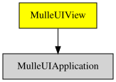

# 📐 MulleUIView

#### 📐 MulleUIView for layout and events

A UIView combines one or multiple UILayers. Multiple UIViews form a hierarchy.
Whereas a UILayer is independent of any other UILayer, a UIView
can have a parent, siblings and desecendants. UILayer is a protocol,
typically `CALayer` will be the concrete class being used as layer.

A UIView provides two services in a program

* layout
* event processing

A UIView does no drawing. All drawing is done by CALayer and its subclasses.
Every UIView must have at least one CALayer. But a CALayer can be invisible.

UIView therefore imposes a structure (layout) on CALayers and facilitates the
routing of events from the event receiver (usually a UIWindow or the
UIApplication) to the code managing the CALayer (a UIView subclass ?).

### You are here

MulleUIView is only based on
[MulleObjCLockFoundation](//github.com/MulleFoundation/MulleObjCFoundation).
Foundation datatypes like `NSString` are not available.
