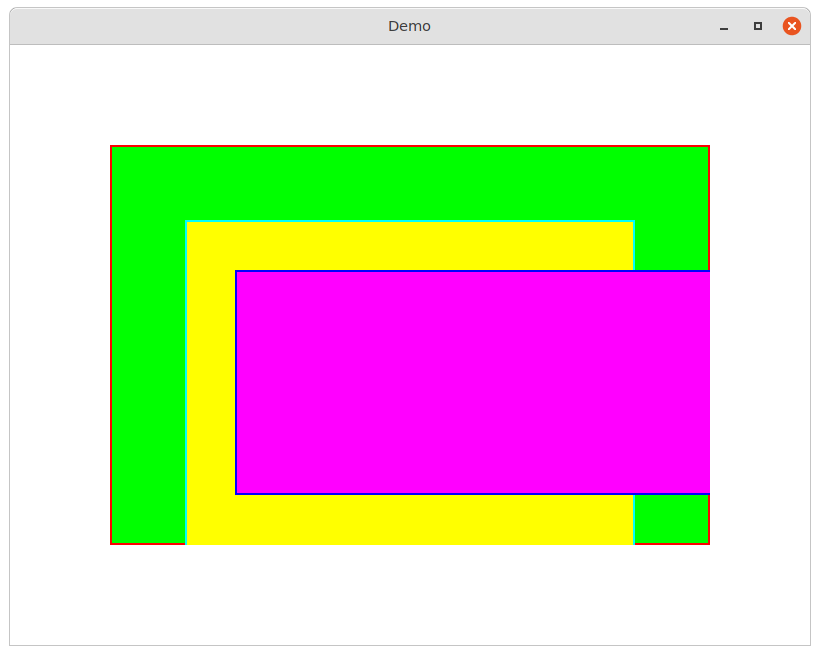
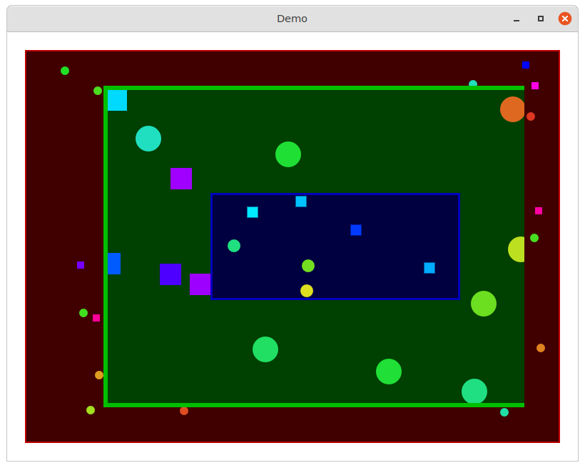
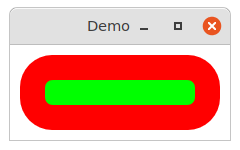
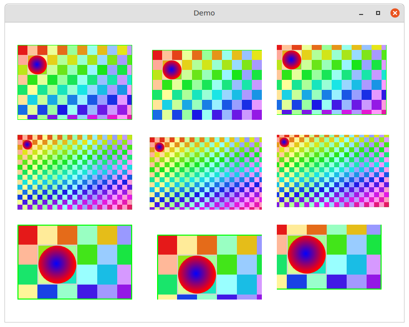

# demo

#### 🛸 demos of UIView functionality


## clip

This demo shows clipping in effect on UIViews.




## click

This demo shows event handling with nested UIViews. Click with the mouse
to create dots. Though the views are nested and some have offset bounds,
the click coordinates are properly calculated.

It also shows hot drawing code is the task of the layer and event handling is
the task of the view.




## layer

Access the layer of a UIView and manipulate some layer settings.




## view-bounds

A view draws a colored checkerboard. Another view draws a circle with a gradient.
The circle view is a subview of the checkerboard view.

Bounds of the superview are "inherited" by the subview. Notice how the circle
is perfectly resized and repositioned along with the checkerboard drawing by
the background layer of the superview, whenever the bounds of the superview
changes.



## mulle-sde

This is a [mulle-sde](//github.com/mulle-sde) project. mulle-sde combines
recursive package management with cross-platform builds via **cmake**:

Action  | Command                               | Description
--------|---------------------------------------|---------------
Build   | `mulle-sde craft [--release|--debug]` | Builds into local `kitchen` folder
Install | `mulle-sde install --prefix /usr/local https://github.com/<|GITHUB_USER|>/demo.git` | Like `make install`


### Manual Installation


Install the requirements:

Requirements                                      | Description
--------------------------------------------------|-----------------------
[some-requirement](//github.com/some/requirement) | Some requirement

Install into `/usr/local`:

```
mkdir build 2> /dev/null
(
   cd build ;
   cmake -DCMAKE_INSTALL_PREFIX=/usr/local \
         -DCMAKE_PREFIX_PATH=/usr/local \
         -DCMAKE_BUILD_TYPE=Release .. ;
   make install
)
```


<!--
extension : mulle-sde/sde
directory : demo/all
template  : .../README.md
Suppress this comment with `export MULLE_SDE_GENERATE_FILE_COMMENTS=NO`
-->
